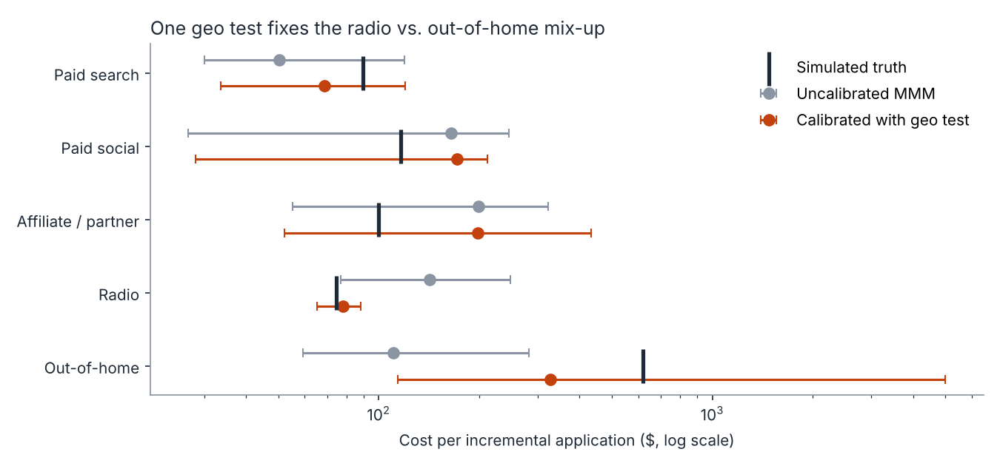
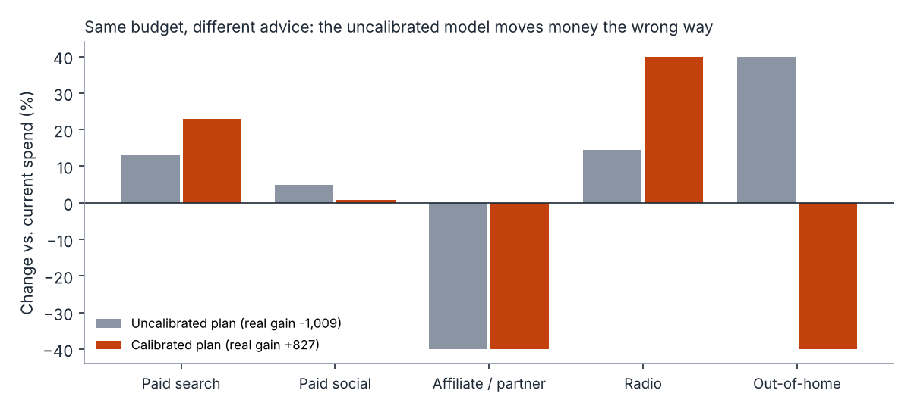
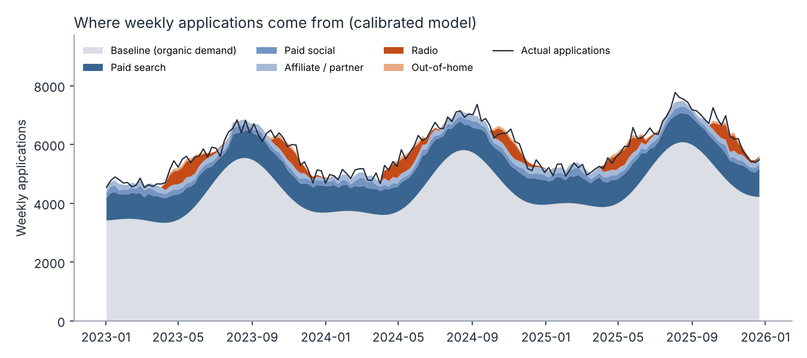
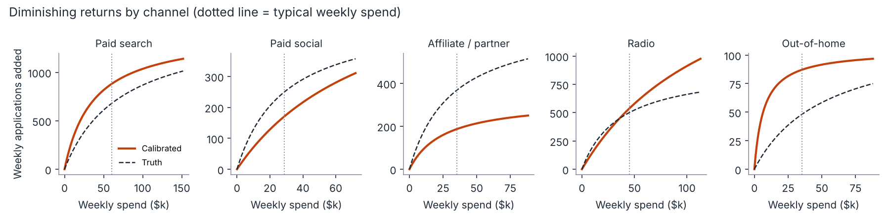

# Media Mix Modeling, Calibrated With a Geo Test

A marketing mix model will always give you an answer. The question is whether you should move budget on it.

This project builds a transparent media mix model (MMM) across five channels. It shows where an MMM fitted on observational data alone goes wrong, then fixes it by anchoring the model to a geo experiment, the kind measured in my [geo-lift-incrementality](https://github.com/PrajaktaTalathi/geo-lift-incrementality) project. Last, it turns the result into a budget recommendation and says where the next experiment should go.

> **Data note:** everything here runs on a **synthetic** dataset generated by `src/simulate.py`. Because the data is simulated, the true effect of every channel is known, so we can check each model against the truth. That's something you never get with real data. The setup mirrors acquisition-marketing measurement I've led in a previous role (always-on digital plus radio and out-of-home brand bursts), but no real company data is used or shown.



## The question a marketing leader actually asks

*"We spend about $7.6M a year across search, social, affiliates, radio and out-of-home. Which channels are earning their keep, and how should next year's budget be split?"*

A good answer has to say:

1. **What does each channel really cost per incremental customer?** Not per click or per attributed conversion, but per outcome that wouldn't have happened without the spend.
2. **How sure are we?** A range, not just a point estimate.
3. **What should we do with the budget?** Including when the honest answer is "test before you move."

## Why an MMM needs an experiment

In this dataset, radio and out-of-home (OOH) run in the same brand bursts (spend correlation 0.89). That's normal: brand teams flight them together. But it means the data alone can't tell them apart. The model sees applications rise during bursts and has to guess how to split the credit.

The uncalibrated model guesses wrong. It makes **radio look twice as expensive** as it really is ($142 vs a true $75 per incremental application) and **OOH look more than five times cheaper** ($111 vs a true $621).

A geo test on one radio burst measured 4,852 ± 692 incremental applications. Feeding that one number into the fit is enough to correct both channels: radio comes back at $78 and OOH at $327. OOH's interval is still wide, but now correctly says it may add little or nothing.

| Channel | Spend (52 wks) | True CPIA | Uncalibrated | Calibrated |
|---|---:|---:|---:|---:|
| Paid search | $3.06M | $90 | $50 ($30–119) | $69 ($34–120) |
| Paid social | $1.47M | $116 | $165 ($27–245) | $171 ($28–212) |
| Affiliate / partner | $1.91M | $100 | $199 ($55–322) | $198 ($52–434) |
| **Radio** | $0.63M | **$75** | **$142** ($77–248) | **$78** ($65–88) |
| **Out-of-home** | $0.50M | **$621** | **$111** ($59–283) | **$327** ($114–no lift) |

*CPIA = cost per incremental application. Ranges are 80% bootstrap intervals.*

## From model to budget decision

Both models were asked the same question: keep the total budget the same, move each channel by at most ±40% (to stay within spend levels the model has seen), and maximize incremental applications.



Because the data is simulated, both plans can be scored against the truth:

| Plan | What the model promised | What it actually delivers |
|---|---:|---:|
| Uncalibrated | +1,973 applications | **−1,009** (worse than doing nothing) |
| Calibrated | +3,629 applications | **+827** |

Two lessons a leadership team should hear:

- **The uncalibrated model moves money the wrong way.** It pours budget into OOH, the least efficient channel, and loses applications.
- **Even the calibrated model over-promises.** It's still unsure about the channels that haven't been tested. Treat any MMM's projected gain as an upper bound until it's been tested.

## Where the next experiment should go

Both plans cut **affiliate spend by 40%** (about $766K). But the model can only place affiliate's cost somewhere between $52 and $434 per application, and the truth is $100, roughly as efficient as search. Acting on that cut would be a mistake.

So the recommendation isn't "cut affiliates." It's: **run a holdout test on affiliate/partner spend before making that move,** then feed the result back into the model the same way the radio geo test was. Each experiment narrows the model's uncertainty where the money is.

## How the model works

| Piece | What it does | Why it matters |
|---|---|---|
| **Adstock** | Lets each channel's effect carry into later weeks | Radio and OOH keep working after the burst ends; ignoring that undervalues them |
| **Saturation (diminishing returns)** | Each extra dollar buys less than the one before | Without it, a model tells you to put the whole budget in one channel |
| **Baseline** | Trend plus yearly seasonality | Separates organic demand from what media drove |
| **Calibration** | Adds the geo-test result as one weighted observation | The weight is set by the test's precision: a tight test pulls hard, a noisy one gently |
| **Block bootstrap** | Refits on resampled residuals (8-week blocks) and redraws the geo result within its error | Honest ranges that include the experiment's own uncertainty |
| **Out-of-sample check** | Trains on 130 weeks, predicts the last 26 | 2.3% error on weeks the model never saw |





## What I'd do in production

- **Keep a test calendar.** Plan geo tests and holdouts across the year so every major channel is calibrated at least annually, starting with the highest spend × uncertainty.
- **Measure to the outcome that matters.** Model funded loans or paid customers, not just applications, and report cost per incremental customer next to CAC and LTV.
- **Use priors properly.** A Bayesian MMM (for example PyMC-Marketing or Meridian) carries the experiment in as a prior and gives full posterior ranges. The approach here is the same idea, kept small enough to read in one sitting.
- **Watch for demand-driven spend.** Search budgets often rise *because* demand is up, which flatters search. Budget tests and holdouts are the cure.
- **Report ranges, not points.** Show leadership the interval and the decision it supports, and say what the model can't tell us.

## Run it

```bash
pip install -r requirements.txt
python run_analysis.py
```

This regenerates `data/weekly_media.csv`, prints the readout (also saved to `charts/readout.txt`) and writes the charts. It takes a couple of minutes, mostly for the bootstrap.

## Project structure

```
├── run_analysis.py        # end-to-end: fit, calibrate, bootstrap, budget re-split, readout, charts
├── src/
│   ├── simulate.py        # synthetic weekly spend + applications, true channel effects, geo-test result
│   └── mmm.py             # adstock + saturation MMM, calibration, bootstrap, budget optimizer
├── data/weekly_media.csv  # generated data
└── charts/                # generated charts and readout.txt
```

## About me

I'm Prajakta Talathi, a Toronto-based marketing measurement and growth analytics leader with 16+ years across FinTech, global consulting and banking technology. I build the measurement and planning that turn marketing spend into decisions leadership can defend.

[LinkedIn](https://www.linkedin.com/in/prajaktatalathi/) · [Tableau Public](https://public.tableau.com/profile/prajakta.talathi) · [Geo lift project](https://github.com/PrajaktaTalathi/geo-lift-incrementality)
